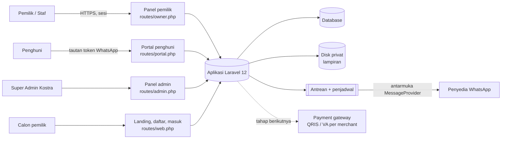

# ARCHITECTURE.md

Arsitektur Kostra: SaaS manajemen kos multi-tenant di atas Laravel 12. Dokumen ini menjelaskan bentuk sistem dan alasan di baliknya. Kebutuhan ada di `docs/prd.md`, skema di `docs/database.md`, aturan kerja agen di `AGENTS.md`.

Status: rancangan awal sebelum implementasi. Bagian bertanda **Terbuka** belum diputuskan (lihat bagian 15).

## 1. Prinsip

1. **Sederhana dulu.** Satu aplikasi Laravel monolit, satu database, satu antrean. Pengembang tunggal, jadi biaya operasional dan beban kognitif harus rendah.
2. **Uang harus benar.** Angka rupiah integer, transaksi database, constraint di database, bukan hanya validasi aplikasi.
3. **Isolasi tenant tidak bisa ditawar.** Satu pemilik tidak boleh melihat data pemilik lain lewat jalur apa pun.
4. **Kostra tidak menahan dana.** Pembayaran dicatat, tidak diproses. Ini menurunkan risiko hukum dan operasional.
5. **Penyedia luar bisa diganti.** WhatsApp dan pembayaran online diakses lewat antarmuka, bukan dipanggil langsung dari logika bisnis.

## 2. Konteks sistem



Empat permukaan, satu basis kode. Pemisahannya lewat file route, middleware, dan namespace controller, bukan lewat layanan terpisah.

## 3. Stack

| Lapisan | Pilihan | Catatan |
| --- | --- | --- |
| Bahasa dan kerangka | PHP, Laravel 12 | |
| Tampilan | Blade, Tailwind CSS v4, Vite | Kelas komponen di `resources/css/app.css` |
| Interaksi | Alpine.js, Livewire | Hanya di tempat yang butuh. Panel Filament **Terbuka** |
| Database | MySQL 8 atau PostgreSQL | **Terbuka**. Skema ditulis netral |
| Antrean dan cache | Database atau Redis | **Terbuka**. Mulai dengan database queue |
| Berkas | Disk privat lokal, bisa pindah ke S3 kompatibel | Lewat `Storage` |
| Tes | Pest atau PHPUnit | **Terbuka**, ikuti yang dipasang skeleton |
| Format | Laravel Pint | |

## 4. Struktur kode

```
app/
  Actions/          aksi bisnis, satu kelas satu aksi (IssueInvoice, RecordPayment, CheckInResident, ...)
  Enums/            InvoiceStatus, RoomStatus, LeaseStatus, PaymentStatus, ...
  Http/
    Controllers/{Owner,Portal,Admin}/
    Middleware/     ResolveTenant, EnsureTenantActive, EnsurePortalToken, ...
    Requests/       Form Request per aksi
  Jobs/             SendMessage, IssueMonthlyInvoices, MarkOverdueInvoices, ...
  Models/           Eloquent; Concerns/BelongsToTenant
  Policies/         satu per model
  Services/
    Messaging/      MessageProvider, FakeProvider, implementasi nyata
    Reports/        kueri laporan
  View/Components/  komponen Blade (room-plate, status-badge, panel, ...)
routes/
  web.php owner.php portal.php admin.php console.php
resources/views/    layouts, components, owner, portal, auth, admin
database/           migrasi, seeder (PlanSeeder, template pesan, kategori pengeluaran)
docs/               prd.md, database.md, implementation-plan.md, DESIGN.md, mockup/
```

`bootstrap/app.php` memuat `owner`, `portal`, dan `admin` lewat `withRouting(... then: ...)` dengan prefix dan middleware group masing-masing. Penjadwal didaftarkan di `routes/console.php`.

## 5. Lapisan dan alur request

```
Route -> Middleware -> Controller -> FormRequest (validasi + authorize)
      -> Action (transaksi, aturan bisnis) -> Model (scope tenant)
      -> Response (Blade / redirect / JSON kecil)
```

- **Controller** hanya menerjemahkan HTTP ke pemanggilan Action.
- **Action** adalah satu-satunya tempat aturan bisnis. Dipakai juga oleh Job, perintah artisan, dan seeder, sehingga perilakunya sama dari mana pun dipanggil.
- **Policy** memeriksa peran dan izin. Setiap route di grup `owner` melewati middleware autentikasi, tenant aktif, dan peran.
- **Model** tidak berisi logika alur. Hanya relasi, cast Enum, scope, dan aksesor ringan.

## 6. Multi-tenancy

Model: satu database, kolom `tenant_id` di semua tabel milik pemilik kos.

- **Resolusi:** tenant diambil dari pengguna yang login (`users.tenant_id`) atau dari token portal. Bukan dari subdomain pada tahap awal.
- **Penegakan:** trait `BelongsToTenant` menambah global scope `tenant_id` dan mengisi `tenant_id` otomatis saat `creating`. Setiap tabel tenant punya `tenant_id` sebagai kolom pertama indeks gabungan.
- **Di luar request:** Job dan perintah artisan tidak punya pengguna login. Konteks tenant diteruskan eksplisit (id tenant di payload Job, lalu di-set sebelum menjalankan Action). Penjadwal yang berlaku lintas tenant (misalnya menerbitkan tagihan) melakukan iterasi tenant dan menjalankan tiap tenant dalam konteksnya.
- **Super Admin:** `users.tenant_id` null. Panel admin boleh melewati scope, hanya di namespace `Admin`, dan impersonasi tercatat di `audit_logs`.
- **Pengujian:** tes isolasi otomatis per fitur (pengguna tenant A mencoba URL dan id milik tenant B, hasilnya 404). Subagent `tenant-auditor` memeriksa query yang melewati scope.
- **Risiko yang diterima:** kesalahan satu query bisa membocorkan data. Mitigasi: scope global, tes isolasi, larangan `withoutGlobalScopes` dan `DB::table` pada tabel tenant (lihat `AGENTS.md`).

## 7. Autentikasi dan otorisasi

| Peran | Autentikasi | Otorisasi |
| --- | --- | --- |
| Pemilik | Email atau WhatsApp dan kata sandi | Semua fitur tenant |
| Staf | Akun lewat undangan sekali pakai (7 hari) | Menu terbatas. Bawaan: menu Keuangan (Pengeluaran, Laporan), Pengaturan, dan Langganan tersembunyi; izin tambahan di `users.permissions` (mis. `finance.view`, `settings.manage`) |
| Penghuni | Tautan token, tanpa akun | Hanya data miliknya |
| Super Admin | Akun tanpa tenant | Semua tenant. Impersonasi (tercatat di audit) adalah fitur fase belakang, bukan MVP awal |

**Portal penghuni.** Token acak dikirim lewat WhatsApp. Basis data hanya menyimpan hash SHA-256 (`portal_tokens.token_hash`). Token punya kedaluwarsa, dapat dicabut pemilik, dan hanya berlaku untuk satu penghuni. Setelah tautan dibuka, sesi Laravel terbatas dibuat sehingga tidak ada data penghuni lain yang bisa diakses. Pembatasan laju diterapkan pada rute portal.

**Pembatasan paket.** Batas properti, kamar, staf, dan kuota pesan dibaca dari `plans` lewat tenant. Pemeriksaan dilakukan di sisi server saat membuat data baru; melewati batas menampilkan tawaran naik paket, bukan galat.

## 8. Model domain

Skema lengkap di `docs/database.md`. Kelompok dan hubungan intinya:

```
plans -- tenants -- users -- invitations
                 \- subscriptions -- subscription_invoices
tenants -- properties -- rooms -- (room_types)
tenants -- residents
rooms ---- leases ---- lease_residents ---- residents
              |-- lease_deposits
              |-- room_transfers
              \-- invoices -- invoice_items
                          |-- invoice_adjustments
                          |-- payment_allocations -- payments
                          \-- payment_proofs
complaints -- complaint_comments
expenses -- expense_categories
message_templates, message_logs, usage_counters, portal_tokens, audit_logs
attachments (polimorfik), number_sequences, payment_accounts, billing_settings (per tenant)
```

**Invarian yang dijaga database:**

| Invarian | Mekanisme |
| --- | --- |
| Satu kontrak aktif per kamar | unique `leases.active_room_id` (diisi selama aktif, null bila tidak) |
| Satu tagihan bulanan per kontrak per periode | unique `(lease_id, period)` |
| Nomor tagihan dan kuitansi unik per tenant | unique `(tenant_id, number)`, `(tenant_id, receipt_number)` |
| Nomor tanpa celah | `number_sequences` dikunci `lockForUpdate` dalam transaksi |
| Satu alokasi per pasangan pembayaran dan tagihan | unique `(payment_id, invoice_id)` |
| Satu deposit per kontrak | unique `lease_id` |
| Kuota pesan tidak dilewati paralel | unique `(tenant_id, metric, period)` dan kenaikan atomik |

Uang selalu integer rupiah: total dan saldo `bigInteger`, harga katalog (mis. `plans`, tarif kamar) `unsignedInteger` sesuai `docs/database.md`; tidak pernah float atau decimal. Tanggal bisnis memakai `date`, kejadian memakai timestamp UTC, tampilan memakai zona waktu tenant (bawaan Asia/Makassar).

## 9. Alur kritis

### 9.1 Check-in
Satu transaksi: validasi kamar kosong, buat `leases` dengan `active_room_id`, hubungkan penghuni di `lease_residents`, catat deposit, ubah status kamar menjadi `occupied`, tulis `audit_logs`. Jika dua pemilik atau staf melakukannya bersamaan, constraint unique membuat satu gagal dengan pesan yang jelas.

### 9.2 Penerbitan tagihan bulanan
1. Penjadwal harian memilih tenant dan kontrak aktif yang jatuh tempo untuk diterbitkan sesuai `billing_settings.issue_day`.
2. Per kontrak, dalam transaksi: ambil nomor dari `number_sequences` (`lockForUpdate`), buat `invoices` dan `invoice_items`, hitung `subtotal` dan `total`.
3. Bila `(lease_id, period)` sudah ada, lewati. Menjalankan ulang aman (idempoten).
4. Setelah commit, antre pesan "tagihan terbit".

Kegagalan satu kontrak tidak menghentikan yang lain; dicatat dan masuk pemantauan.

### 9.3 Pencatatan pembayaran
Satu transaksi: kunci baris tagihan terkait, buat `payments`, buat `payment_allocations` (jumlah tidak melebihi pembayaran maupun sisa tagihan), hitung ulang `paid_total` dan status tagihan (`partial` atau `paid`), terbitkan nomor kuitansi, tulis audit. Kuitansi dikirim setelah commit.

Pembatalan pembayaran: ubah status menjadi `voided` dengan alasan, hitung ulang tagihan terkait, catat audit. Tidak ada penghapusan.

### 9.4 Bukti transfer
Penghuni mengunggah bukti lewat portal (`payment_proofs`, status `pending`, berkas di `attachments`). Pemilik atau staf menyetujui atau menolak. Persetujuan menjalankan Action pencatatan pembayaran yang sama (9.3) dan mengisi `payment_proofs.payment_id`. Penolakan wajib beralasan dan memberi tahu penghuni. Bukti `pending` lebih dari 3 hari memicu pengingat ke pemilik.

### 9.5 Status terlambat
Penjadwal harian mengubah tagihan `issued` atau `partial` yang melewati `due_date` menjadi `overdue`. Perubahan status memicu pengingat sesuai jadwal.

### 9.6 Notifikasi WhatsApp
1. Peristiwa bisnis (tagihan terbit, hari jatuh tempo, tunggakan, kuitansi, kontrak segera habis) membuat catatan di `message_logs` berstatus `queued` dan Job `SendMessage`.
2. Job memeriksa: penghuni tidak opt-out, jam kirim (di luar jendela ditunda), kuota paket.
3. Pengiriman lewat antarmuka `MessageProvider`. Hasil (id pesan, status, kode galat) disimpan; percobaan ulang terbatas dengan backoff.
4. Webhook penyedia memperbarui status pengiriman.

Gagal kirim tidak pernah membatalkan transaksi bisnis. Email dan notifikasi dalam aplikasi menjadi cadangan.

## 10. Penjadwal dan antrean

| Tugas | Frekuensi | Catatan |
| --- | --- | --- |
| Terbitkan tagihan bulanan | Harian | Idempoten, per tenant |
| Tandai tagihan terlambat | Harian | |
| Kirim pengingat | Beberapa kali sehari | Mengikuti `reminder_offsets` dan jendela kirim |
| Pengingat kontrak segera habis | Harian | 30, 14, 7 hari |
| Pengingat bukti transfer tertunda | Harian | Lebih dari 3 hari |
| Perbarui langganan dan masa tenggang | Harian | Percobaan 14 hari, tenggang 7 hari |
| Bersihkan token portal kedaluwarsa | Harian | |

Pekerjaan gagal tercatat di `failed_jobs` dan terlihat di pemantauan. Semua tugas aman dijalankan ulang.

## 11. Penyimpanan berkas

Satu tabel polimorfik `attachments`, disk privat, tanpa URL publik. Penyajian lewat tautan bertanda tangan berumur pendek yang melewati Policy. Foto KTP: `is_sensitive = true`, dienkripsi saat disimpan, tiap akses dicatat ke `audit_logs`. Nomor KTP tidak pernah disimpan sebagai teks. Batas unggahan: JPG, PNG, atau PDF hingga 5 MB, divalidasi di server.

## 12. Antarmuka penyedia luar

**MessageProvider** menyembunyikan penyedia WhatsApp. Satu kelas adapter per penyedia dan `FakeProvider` untuk pengembangan dan tes. Mengganti penyedia berarti menambah adapter dan konfigurasi, tanpa menyentuh Action. Penyedia dan tarif per pesan **Terbuka**; tarif Indonesia belum diverifikasi.

**Pembayaran online** (QRIS, virtual account) belum ada di MVP. Bila ditambahkan, hanya lewat penyedia berizin dengan akun per merchant sehingga dana langsung ke pemilik, dan callback dicocokkan ke `payment_allocations` yang sama.

## 13. Frontend

- **Layout:** `layouts/owner` (sidebar dan header), `layouts/portal` (mobile-first, tabbar bawah); panel pemilik memakai navigasi bawah di ponsel, `layouts/guest` (autentikasi), `layouts/admin`.
- **Gaya:** `DESIGN.md` adalah sumber desain (palet emerald `#0D7A5F`, Slate Navy `#1E293B`, Warm Amber `#D97706`; Inter untuk isi, Plus Jakarta Sans untuk judul). Tailwind v4: token dan kelas komponen di `resources/css/app.css` (berasal dari `docs/mockup/app.css`, yang menerjemahkan DESIGN.md). Blade component membungkus kelas supaya view bersih. Bila mockup dan DESIGN.md berbeda, DESIGN.md yang benar.
- **Interaksi:** Alpine untuk modal dan menu; Livewire hanya untuk bagian yang butuh pembaruan tanpa muat ulang (daftar dengan filter, form dinamis).
- **Mockup:** `docs/mockup/` adalah acuan tata letak dan teks. Peta layar ke view dan route ada di `docs/mockup/README.md`.
- **Aksesibilitas:** status selalu teks dan warna; kontras diuji; portal nyaman di layar 360 px.

## 14. Keamanan dan privasi

- Tenant yang ditangguhkan (langganan berakhir) menjadi baca-saja; pemilik tetap dapat mengekspor datanya.

- HTTPS di seluruh lalu lintas, cookie sesi `secure` dan `httponly`, kata sandi di-hash, proteksi CSRF bawaan.
- Pembatasan laju untuk login, reset kata sandi, dan portal.
- Otorisasi berlapis: middleware peran, Policy per model, scope tenant.
- Audit untuk aksi penting: ubah harga, hapus penghuni, batalkan pembayaran, akses foto KTP, impersonasi.
- Log aplikasi tidak memuat data pribadi.
- Persetujuan pengumpulan data penghuni dicatat (`residents.consented_at`). Permintaan hapus data diproses dengan anonimisasi tanpa menghapus catatan keuangan. Kepatuhan UU Pelindungan Data Pribadi perlu ditinjau penasihat hukum sebelum peluncuran.
- Cadangan basis data harian dengan uji pemulihan berkala (retensi awal 14 hari).

## 15. Keputusan terbuka

| # | Keputusan | Pilihan | Kapan diputuskan |
| --- | --- | --- | --- |
| 1 | Mesin database | MySQL 8 atau PostgreSQL | Fase 0 |
| 2 | Panel pemilik | Blade, Alpine, Livewire (sesuai mockup) atau Filament | Fase 0 |
| 3 | Penyedia WhatsApp dan tarif | Resmi (Cloud API) atau lewat penyedia pihak ketiga | Sebelum fase 9 |
| 4 | Foto KTP wajib atau opsional pada pilot | Opsional per kebijakan pemilik | Sebelum fase 3 |
| 5 | Staf boleh membatalkan pembayaran dan menghapus data | Usulan: tidak | Fase 1 |
| 6 | Hosting dan deploy | VPS, PaaS, atau lainnya; cadangan dan pemantauan | Fase 12 |
| 7 | Queue dan cache | Database atau Redis | Fase 9 |
| 8 | Domain dan merek | Pemeriksaan nama Kostra, domain, DJKI | Sebelum pilot |
| 9 | Harga akhir paket langganan | Angka di mockup dan seeder hanya contoh | Sebelum pilot |

Keputusan yang diambil dicatat sebagai baris baru di bawah ini (tanggal, keputusan, alasan) dan diperbarui di tabel.

## 16. Pengujian

- **Tes fitur** per Action dan per route, dengan pengguna dan tenant uji.
- **Tes isolasi tenant** wajib untuk setiap fitur yang menyentuh data pemilik.
- **Tes uang:** pembulatan, alokasi parsial, pembatalan, tagihan ganda, kuota paralel.
- **Tes penjadwal:** menjalankan dua kali menghasilkan hasil yang sama.
- **Tes penyedia:** `FakeProvider`, tanpa pengiriman nyata.
- **Pemeriksaan manual per fase:** `/cek-fase N` pada Claude Code, lalu uji di lebar ponsel dan desktop.

## 17. Deploy dan operasional

Belum diputuskan (keputusan 6). Kebutuhan minimum: PHP-FPM atau setara, worker antrean yang diawasi (Supervisor atau sejenisnya), cron satu menit untuk `schedule:run`, penyimpanan berkas yang tidak ikut terhapus saat rilis, cadangan harian, pemantauan galat, dan halaman status sederhana. Panduan rinci ditulis di `docs/deploy.md` pada fase 12.

## 18. Riwayat keputusan

| Tanggal | Keputusan | Alasan |
| --- | --- | --- |
| 2026-10 | Satu database multi-tenant dengan `tenant_id` | Murah dioperasikan untuk pengembang tunggal |
| 2026-10 | Kostra tidak menahan dana | Hindari risiko hukum dan operasional pada MVP |
| 2026-10 | Uang sebagai integer rupiah | Tanpa galat pembulatan |
| 2026-10 | Portal penghuni lewat tautan token | Adopsi mudah; penghuni tidak perlu akun |
| 2026-10 | Nomor KTP tidak disimpan | Minimalkan data pribadi |
| 2026-10 | DESIGN.md (Stitch) menjadi sumber desain, menggantikan palet navy dan kuningan di mockup awal | Satu sumber visual yang konsisten |
| 2026-10-27 | Fase 0: MySQL, panel pemilik Blade tanpa Filament (Livewire/Alpine ditambah saat dibutuhkan), PHPUnit, antrean dan sesi driver database | Sesuai rekomendasi rencana Fase 0; ekstensi pdo_mysql sudah ada di lingkungan lokal |
| 2026-10-27 | Fase 3: foto KTP opsional dengan peringatan (keputusan terbuka 4); staf tidak boleh menganonimkan data penghuni (usulan keputusan 5); izin `documents.view` untuk dokumen sensitif | Meminimalkan data pribadi; pemilik tetap pengendali utama |
| 2026-10-27 | Data pribadi penghuni tidak disalin ke audit_logs (nilai disamarkan), dan penghapusan data berarti anonimisasi | Audit bersifat append-only sehingga tidak boleh menyimpan data yang kelak harus dihapus |
| 2026-10-27 | Fase 4: status aktif penghuni dikelola kontrak (check-in/out); deposit dipindah ke kontrak baru saat perpanjangan; potongan deposit dan perubahan harga hanya pemilik | Satu sumber kebenaran untuk keaktifan; skema membatasi satu deposit per kontrak; keputusan uang di tangan pemilik |
