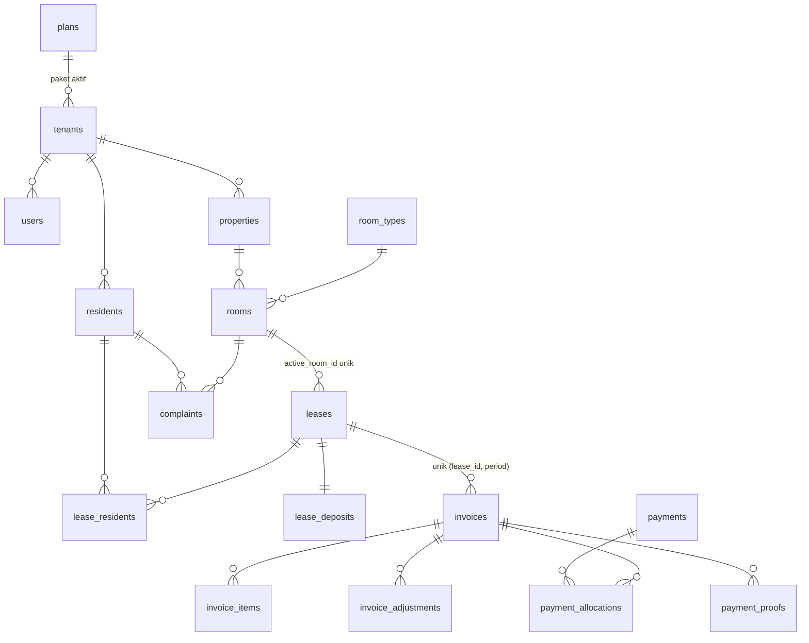

# Desain Database Kostra

Diperbarui 20 Oktober 2026

## 1. Keputusan desain dan konvensi

Skema MVP terdiri dari 33 tabel dalam 9 kelompok, dan semua data milik pemilik kos memuat kolom tenant_id sehingga satu database melayani banyak tenant. Desain ini mengikuti PRD Kostra dan cocok untuk MySQL 8 maupun PostgreSQL; tipe kolom ditulis dengan nama method migrasi Laravel supaya mudah diterjemahkan.

| Aspek | Keputusan | Alasan |
| --- | --- | --- |
| Multi-tenant | Satu database, kolom tenant_id di semua tabel milik pemilik, global scope lewat trait BelongsToTenant | Murah dioperasikan; isolasi diuji otomatis (PRD FND-03) |
| Primary key | bigint auto-increment (id()) | Sederhana; URL publik portal memakai token, bukan id |
| Uang | unsignedBigInteger dalam rupiah penuh; nilai yang boleh negatif (penyesuaian) memakai bigInteger | Tanpa pecahan, bebas galat pembulatan |
| Tanggal | date untuk tanggal bisnis (jatuh tempo, mulai kontrak); timestamp UTC untuk kejadian | Laporan per hari tidak bergeser; tampil dalam zona waktu tenant (default Asia/Makassar) |
| Enum | Disimpan sebagai string, dipetakan ke PHP Enum di model | Menambah nilai tidak butuh migrasi berat |
| Soft delete | deleted_at pada properties, rooms, residents, users, expenses | Data keuangan (invoices, payments) tidak dihapus, hanya berstatus void |
| Lampiran | Satu tabel polimorfik attachments di disk privat | Dipakai KTP, bukti transfer, foto komplain, dan nota |
| Foreign key | restrictOnDelete untuk data keuangan; cascadeOnDelete hanya untuk anak murni | Mencegah hilangnya riwayat uang tanpa sengaja |
| Stempel waktu | created_at dan updated_at di semua tabel kecuali dinyatakan lain | Standar Laravel |

### Perbedaan dari PRD

Beberapa tabel pada daftar "Data utama" PRD disederhanakan agar skema lebih ramping tanpa mengurangi fungsi.

| Di PRD | Di desain ini |
| --- | --- |
| resident_documents, complaint_attachments | Satu tabel attachments |
| emergency_contacts | Kolom kontak darurat di residents |
| facilities | Kolom json facilities di room_types dan rooms |
| receipts | Kolom nomor dan waktu kuitansi di payments |
| checkin_records | Kolom check-in dan check-out di leases |
| portal_sessions | Dihapus; portal memakai sesi Laravel setelah token divalidasi |
| notification_preferences | Kolom opt-out di residents dan jam kirim di billing_settings |

## 2. Diagram relasi

Tagihan lahir dari kontrak, dan pembayaran menempel ke tagihan lewat alokasi, sehingga satu pembayaran dapat melunasi beberapa tagihan. Diagram hanya menggambar relasi inti agar terbaca; kolom lengkap ada di bagian 3 sampai 10.

Kamar dan penghuni menjadi poros: kontrak mempertemukan keduanya, sedangkan komplain, pesan, dan pembayaran bergantung pada penghuni atau kamar yang sama.

## 3. Platform dan tenant

Tujuh tabel ini mengatur siapa pemilik kos, apa paketnya, dan siapa yang boleh masuk. Hanya users yang boleh memiliki tenant_id kosong (untuk Super Admin); plans milik platform, sedangkan tabel lain di kelompok ini selalu terikat ke satu tenant. Setiap tabel di dokumen ini juga punya id, created_at, dan updated_at kecuali dinyatakan lain.

### plans

| Kolom | Tipe | Catatan |
| --- | --- | --- |
| key | string(30) unique | free, starter, pro, business |
| name | string(60) | Nama tampil |
| price_monthly | unsignedInteger | Rupiah per bulan |
| price_yearly | unsignedInteger null | Null bila tidak ada paket tahunan |
| max_properties | unsignedSmallInteger null | Null = tanpa batas |
| max_rooms | unsignedInteger null | Null = tanpa batas |
| max_users | unsignedSmallInteger null | Batas staf per tenant |
| monthly_message_quota | unsignedInteger | Kuota pesan WhatsApp per bulan |
| features | json | Daftar fitur aktif (misalnya reports.advanced) |
| is_active, sort_order | boolean, unsignedTinyInteger | Mengatur tampilan daftar paket |

### tenants

| Kolom | Tipe | Catatan |
| --- | --- | --- |
| name | string(120) | Nama usaha kos |
| slug | string(60) unique | Untuk identitas internal dan subdomain nanti |
| plan_id | foreignId, restrict | Paket aktif (disalin dari subscription agar pengecekan batas cepat) |
| status | string(20) | trial, active, suspended, closed |
| phone | string(20) null | Kontak bisnis |
| timezone | string(40) | Default Asia/Makassar |
| logo_path | string null | Logo untuk tagihan dan kuitansi |
| trial_ends_at, suspended_at | timestamp null | Mendukung masa percobaan dan penangguhan |
| settings | json null | Preferensi kecil yang belum perlu kolom sendiri |

### users

| Kolom | Tipe | Catatan |
| --- | --- | --- |
| tenant_id | foreignId null, restrict | Null untuk Super Admin |
| name | string(120) |  |
| email | string null unique | Salah satu email atau phone wajib diisi (validasi aplikasi) |
| phone | string(20) null unique | Format internasional |
| email_verified_at | timestamp null |  |
| password | string | Hash |
| role | string(20) | super_admin, owner, staff |
| permissions | json null | Izin staf, misalnya finance.view, settings.manage |
| is_active | boolean | Default true |
| last_login_at | timestamp null |  |
| remember_token, deleted_at | string(100) null, softDeletes |  |

### invitations

| Kolom | Tipe | Catatan |
| --- | --- | --- |
| tenant_id | foreignId, cascade |  |
| invited_by | foreignId users, restrict |  |
| email, phone | string null | Tujuan undangan |
| role, permissions | string(20), json null | Peran dan izin yang diberikan |
| token_hash | string(64) unique | Hanya hash yang disimpan |
| expires_at, accepted_at | timestamp, timestamp null | Kedaluwarsa 7 hari |
| accepted_user_id | foreignId users null | Pengguna yang dibuat dari undangan |

### subscriptions

| Kolom | Tipe | Catatan |
| --- | --- | --- |
| tenant_id, plan_id | foreignId, restrict |  |
| status | string(20) | trialing, active, past_due, canceled, expired |
| billing_period | string(10) | monthly atau yearly |
| trial_ends_at | timestamp null |  |
| current_period_start, current_period_end | date | Periode berjalan |
| grace_ends_at, canceled_at | timestamp null | Masa tenggang 7 hari dan waktu pembatalan |

### subscription_invoices

| Kolom | Tipe | Catatan |
| --- | --- | --- |
| tenant_id, subscription_id | foreignId, restrict |  |
| number | string(30) unique | Nomor tagihan langganan, terpisah dari tagihan penghuni |
| period_start, period_end | date |  |
| amount | unsignedBigInteger | Rupiah |
| status | string(20) | pending, paid, void |
| due_date, paid_at | date, timestamp null |  |
| payment_method, reference | string null | Transfer manual pada MVP |

### usage_counters

| Kolom | Tipe | Catatan |
| --- | --- | --- |
| tenant_id | foreignId, cascade |  |
| metric | string(30) | whatsapp_messages pada MVP |
| period | char(7) | Format 2026-10 |
| used | unsignedInteger | Default 0; dinaikkan atomik saat pesan dikirim |

Batas properti dan kamar tidak disimpan sebagai penghitung; dihitung langsung dari tabel properties dan rooms saat dicek.

## 4. Properti dan kamar

Kamar adalah poros data operasional: kontrak, tagihan, dan komplain semuanya bermuara ke room_id. Tiga tabel ini mengikuti PRD modul Properti dan Kamar.

### properties

| Kolom | Tipe | Catatan |
| --- | --- | --- |
| tenant_id | foreignId, restrict |  |
| name | string(120) |  |
| address | text null |  |
| city | string(80) null |  |
| floors | unsignedTinyInteger null |  |
| photo_path | string null |  |
| notes | text null |  |
| is_active, deleted_at | boolean, softDeletes |  |

### room_types

| Kolom | Tipe | Catatan |
| --- | --- | --- |
| tenant_id | foreignId, restrict |  |
| property_id | foreignId null, restrict | Null = tipe berlaku untuk semua properti tenant |
| name | string(80) | Unik per (tenant_id, property_id, name) |
| base_price | unsignedInteger | Harga dasar sewa bulanan; perubahan tidak menyentuh kontrak berjalan |
| size_m2 | decimal(5,1) null |  |
| facilities | json null | Daftar fasilitas, misalnya ["AC", "Kamar mandi dalam"] |
| description | text null |  |
| is_active | boolean |  |

### rooms

| Kolom | Tipe | Catatan |
| --- | --- | --- |
| tenant_id, property_id | foreignId, restrict |  |
| room_type_id | foreignId null, restrict |  |
| number | string(20) | Unik per properti (lihat catatan di bawah) |
| floor | unsignedTinyInteger null |  |
| price | unsignedInteger | Harga kamar saat ini; kontrak menyimpan harga yang disepakati sendiri |
| status | string(20) | vacant, occupied, maintenance |
| facilities | json null | Menimpa fasilitas tipe bila diisi |
| notes, deleted_at | text null, softDeletes |  |

Status occupied tidak diatur manual: aksi CheckInResident dan CheckOutResident mengubahnya dalam transaksi yang sama dengan kontrak. Keunikan nomor kamar per properti dijaga validasi aplikasi dengan Rule::unique yang mengabaikan baris terhapus, karena indeks unik database tidak membedakan baris soft delete.

## 5. Penghuni dan lampiran

Data penghuni sengaja dibuat minimal karena memuat data pribadi: nomor KTP tidak disimpan sebagai kolom, hanya foto opsional lewat tabel lampiran yang terenkripsi. Satu baris residents mewakili satu orang, yang bisa memiliki beberapa kontrak dari waktu ke waktu (PRD PNG-03).

### residents

| Kolom | Tipe | Catatan |
| --- | --- | --- |
| tenant_id | foreignId, restrict |  |
| name | string(120) |  |
| phone | string(20) | Nomor WhatsApp, format internasional; indeks (tenant_id, phone) tidak unik agar duplikat bisa ditandai saat impor |
| email | string null |  |
| occupation | string(120) null | Pekerjaan atau kampus |
| emergency_name, emergency_relation, emergency_phone | string null | Satu kontak darurat; cukup untuk MVP |
| notes | text null | Catatan internal pemilik, tidak tampil di portal |
| whatsapp_opt_out_at | timestamp null | Terisi bila penghuni berhenti menerima pesan otomatis |
| consented_at | timestamp null | Waktu persetujuan pengumpulan data dicatat |
| is_active | boolean | False setelah check-out dan tanpa kontrak aktif |
| deleted_at | softDeletes | Permintaan hapus data diproses dengan anonimisasi, bukan menghapus baris keuangan |

### attachments

Satu tabel polimorfik untuk semua berkas: foto KTP, bukti transfer, foto komplain, nota pengeluaran, dan foto kondisi kamar saat check-in atau check-out.

| Kolom | Tipe | Catatan |
| --- | --- | --- |
| tenant_id | foreignId, restrict |  |
| attachable_type, attachable_id | morphs | Resident, PaymentProof, Complaint, Expense, Lease, dan lainnya |
| category | string(30) | ktp, photo, transfer_proof, complaint_photo, expense_receipt, room_condition |
| disk | string(20) | Disk privat; berkas dilayani lewat tautan bertanda tangan |
| path | string | Jalur di penyimpanan |
| original_name | string(255) |  |
| mime, size | string(100), unsignedInteger | Divalidasi saat unggah (JPG, PNG, PDF; maksimum 5 MB) |
| is_sensitive | boolean | True untuk KTP; berkas dienkripsi saat disimpan dan aksesnya dicatat di audit_logs |
| uploaded_by | foreignId users null | Staf atau pemilik yang mengunggah |
| uploaded_by_resident_id | foreignId residents null | Terisi bila diunggah dari portal |

## 6. Kontrak sewa

Kontrak adalah sumber semua tagihan bulanan, dan satu kamar tidak boleh punya dua kontrak aktif. Aturan itu dijaga di database lewat kolom active_room_id yang unik, bukan hanya lewat validasi aplikasi.

### leases

| Kolom | Tipe | Catatan |
| --- | --- | --- |
| tenant_id, property_id, room_id | foreignId, restrict | property_id disalin dari kamar untuk mempercepat filter laporan |
| primary_resident_id | foreignId residents, restrict | Penanggung jawab tagihan |
| status | string(20) | active, ended, canceled |
| active_room_id | unsignedBigInteger null, unique | Diisi room_id selama kontrak aktif, null bila tidak; unique mencegah dua kontrak aktif di satu kamar |
| start_date | date |  |
| end_date | date null | Null bila sewa tanpa tanggal akhir |
| billing_cycle | string(10) | monthly pada MVP |
| rent_amount | unsignedInteger | Harga sewa yang disepakati per siklus |
| due_day | unsignedTinyInteger null | Tanggal jatuh tempo; null = ikut billing_settings |
| renewed_from_lease_id | foreignId leases null | Rantai perpanjangan |
| checked_in_at, checkin_notes | timestamp null, text null | Catatan kondisi kamar saat masuk |
| checked_out_at, checkout_notes | timestamp null, text null | Catatan kondisi kamar saat keluar |
| ended_reason | string(30) null | expired, moved_out, terminated |
| notes | text null |  |

### lease_residents

Menyimpan semua penghuni dalam satu kontrak (pasangan atau kamar berbagi); penanggung jawab ditandai is_primary.

| Kolom | Tipe | Catatan |
| --- | --- | --- |
| tenant_id | foreignId, restrict |  |
| lease_id | foreignId, cascade |  |
| resident_id | foreignId, restrict |  |
| is_primary | boolean | Tepat satu per kontrak; sinkron dengan leases.primary_resident_id |
| unique | (lease_id, resident_id) |  |

### lease_deposits

| Kolom | Tipe | Catatan |
| --- | --- | --- |
| tenant_id | foreignId, restrict |  |
| lease_id | foreignId, restrict, unique | Satu deposit per kontrak |
| amount | unsignedBigInteger | Jumlah yang disepakati |
| received_at | date null | Tanggal diterima |
| status | string(20) | pending, held, refunded, partially_refunded, forfeited |
| deduction_amount, deduction_note | unsignedBigInteger default 0, text null | Potongan saat check-out |
| refund_amount, refunded_at | unsignedBigInteger default 0, date null | Pengembalian ke penghuni |

### room_transfers

| Kolom | Tipe | Catatan |
| --- | --- | --- |
| tenant_id, lease_id | foreignId, restrict |  |
| from_room_id, to_room_id | foreignId rooms, restrict |  |
| transferred_on | date |  |
| new_rent_amount | unsignedInteger null | Harga baru bila berubah; tagihan berikutnya memakai nilai ini |
| reason | string(255) null |  |
| created_by | foreignId users, restrict |  |

Saat pindah kamar, leases.room_id dan active_room_id diperbarui dalam satu transaksi dengan pencatatan di room_transfers, sehingga riwayat kamar lama tetap tersimpan.

## 7. Tagihan

Tagihan bulanan tidak boleh ganda walau penjadwal berjalan dua kali, jadi keunikan (lease_id, period) dipasang di database. Angka yang berubah (total, terbayar) disimpan di invoices agar daftar tunggakan cepat, dan dihitung ulang dari item, penyesuaian, dan alokasi pembayaran dalam transaksi yang sama.

### billing_settings

Satu baris per tenant; menyimpan aturan penagihan dan jadwal pengingat.

| Kolom | Tipe | Catatan |
| --- | --- | --- |
| tenant_id | foreignId, restrict, unique |  |
| invoice_prefix | string(10) | Default INV |
| issue_day | unsignedTinyInteger | Tanggal terbit tagihan bulanan |
| due_day | unsignedTinyInteger | Tanggal jatuh tempo bawaan; dapat ditimpa leases.due_day |
| prorate_first_month, prorate_last_month | boolean | Pro rata bulan pertama dan terakhir |
| late_fee_type, late_fee_value | string(10) null, unsignedInteger null | Disiapkan untuk denda (tahap berikutnya); belum dipakai MVP |
| reminder_offsets | json | Hari relatif terhadap jatuh tempo, misalnya [-3, 0, 3] |
| send_window_start, send_window_end | time | Jam kirim pesan; di luar jam ini pesan ditunda |

### number_sequences

Pembangkit nomor tanpa celah dan tanpa duplikat per tenant, dibaca dengan penguncian baris di dalam transaksi.

| Kolom | Tipe | Catatan |
| --- | --- | --- |
| tenant_id | foreignId, cascade |  |
| key | string(20) | invoice atau receipt |
| period | char(7) | Format 2026-10 |
| last_number | unsignedInteger | Nomor terakhir yang dipakai |
| unique | (tenant_id, key, period) | Hasil: INV-2026-10-0001 |

### invoices

| Kolom | Tipe | Catatan |
| --- | --- | --- |
| tenant_id, property_id | foreignId, restrict |  |
| lease_id, resident_id | foreignId, restrict | resident_id = penanggung jawab saat tagihan terbit |
| number | string(30) | Unik per (tenant_id, number) |
| type | string(15) | recurring, manual |
| period | char(7) null | Diisi untuk recurring; unique (lease_id, period) mencegah tagihan bulanan ganda, dan baris manual (period null) tidak terkena batasan ini |
| period_start, period_end | date null | Rentang yang ditagih, penting untuk pro rata |
| issue_date, due_date | date |  |
| status | string(20) | draft, issued, partial, paid, overdue, void |
| subtotal | unsignedBigInteger | Jumlah seluruh invoice_items |
| adjustment_total | bigInteger | Jumlah seluruh invoice_adjustments; bisa negatif |
| total | unsignedBigInteger | subtotal + adjustment_total |
| paid_total | unsignedBigInteger | Jumlah alokasi pembayaran aktif; sisa tagihan = total - paid_total (dihitung, tidak disimpan) |
| issued_at, paid_at | timestamp null |  |
| voided_at, void_reason | timestamp null, string(255) null | Pembatalan tercatat, baris tidak dihapus |
| created_by | foreignId users null | Null bila dibuat oleh penjadwal |
| notes | text null |  |

Portal penghuni membuka tagihan lewat token penghuni dan id tagihan, sehingga tidak perlu kolom tautan per tagihan; otorisasinya memastikan resident_id cocok dengan pemilik token.

### invoice_items

| Kolom | Tipe | Catatan |
| --- | --- | --- |
| tenant_id | foreignId, restrict |  |
| invoice_id | foreignId, cascade |  |
| type | string(20) | rent, utility, service, other |
| description | string(255) |  |
| quantity | decimal(10,2) | Default 1; pecahan dipakai untuk meteran pada tahap berikutnya |
| unit_price | unsignedBigInteger |  |
| amount | unsignedBigInteger | quantity x unit_price, dibulatkan ke rupiah |
| meta | json null | Cadangan untuk data meteran |
| sort_order | unsignedTinyInteger |  |

### invoice_adjustments

Koreksi setelah tagihan terbit dicatat di sini, bukan dengan mengubah item asli, sehingga riwayat tetap utuh.

| Kolom | Tipe | Catatan |
| --- | --- | --- |
| tenant_id, invoice_id | foreignId, restrict |  |
| amount | bigInteger | Positif menambah, negatif mengurangi |
| reason | string(255) | Wajib |
| created_by | foreignId users, restrict | Juga tercatat di audit_logs |

## 8. Pembayaran

Pada MVP, tabel ini hanya mencatat uang yang diterima pemilik di luar sistem; Kostra tidak menahan dana. Satu pembayaran bisa melunasi beberapa tagihan lewat payment_allocations, dan pembayaran yang dibatalkan tetap tersimpan sebagai riwayat.

### payment_accounts

| Kolom | Tipe | Catatan |
| --- | --- | --- |
| tenant_id | foreignId, restrict |  |
| property_id | foreignId null, restrict | Null = berlaku untuk semua properti |
| type | string(15) | bank, qris, ewallet |
| bank_name, account_number, account_name | string null | Ditampilkan di tagihan dan portal |
| instructions | text null | Catatan singkat untuk penghuni |
| is_default, is_active | boolean | Gambar QRIS statis disimpan lewat attachments (kategori qris_image) |

### payments

| Kolom | Tipe | Catatan |
| --- | --- | --- |
| tenant_id | foreignId, restrict |  |
| resident_id | foreignId, restrict |  |
| payment_account_id | foreignId null, restrict | Rekening tujuan; null untuk tunai |
| amount | unsignedBigInteger | Total uang yang diterima |
| paid_on | date | Tanggal pembayaran; dasar pengakuan pemasukan di laporan |
| method | string(20) | cash, transfer, qris, ewallet, other |
| reference | string(100) null | Nomor referensi transfer |
| status | string(10) | active, voided |
| voided_at, void_reason, voided_by | timestamp null, string(255) null, foreignId users null | Pembatalan wajib beralasan |
| recorded_by | foreignId users, restrict | Pencatat atau penyetuju bukti transfer |
| receipt_number | string(30) null | Unik per (tenant_id, receipt_number) |
| receipt_issued_at, receipt_sent_at | timestamp null | Kuitansi digital dan waktu terkirim ke penghuni |
| notes | text null |  |

### payment_allocations

| Kolom | Tipe | Catatan |
| --- | --- | --- |
| tenant_id | foreignId, restrict |  |
| payment_id | foreignId, restrict |  |
| invoice_id | foreignId, restrict |  |
| amount | unsignedBigInteger | Bagian pembayaran yang dialokasikan ke tagihan ini |
| unique | (payment_id, invoice_id) | Jumlah alokasi satu pembayaran tidak boleh melebihi payments.amount |

Kolom invoices.paid_total dihitung dari alokasi yang pembayarannya berstatus active, sehingga membatalkan pembayaran otomatis mengembalikan status tagihan setelah dihitung ulang.

### payment_proofs

| Kolom | Tipe | Catatan |
| --- | --- | --- |
| tenant_id | foreignId, restrict |  |
| invoice_id, resident_id | foreignId, restrict |  |
| amount | unsignedBigInteger | Jumlah menurut pengakuan penghuni |
| paid_on | date null |  |
| sender_note | string(255) null | Nama pengirim atau catatan |
| status | string(15) | pending, approved, rejected |
| reviewed_by, reviewed_at | foreignId users null, timestamp null |  |
| reject_reason | string(255) null | Wajib saat ditolak |
| payment_id | foreignId payments null | Terisi saat disetujui dan pembayaran dibuat |

Foto atau PDF bukti disimpan di attachments (kategori transfer_proof). Bukti berstatus pending lebih dari 3 hari memunculkan pengingat ke pemilik.

## 9. Pengeluaran dan komplain

Pengeluaran melengkapi pemasukan agar pemilik melihat saldo bersih, sedangkan komplain menjaga keluhan penghuni tidak tenggelam di chat. Keduanya memakai attachments untuk foto dan nota.

### expense_categories

| Kolom | Tipe | Catatan |
| --- | --- | --- |
| tenant_id | foreignId, restrict |  |
| name | string(80) | Unik per (tenant_id, name) |
| is_system | boolean | True untuk kategori bawaan seperti listrik, air, gaji penjaga, perbaikan, kebersihan |
| sort_order | unsignedTinyInteger |  |

### expenses

| Kolom | Tipe | Catatan |
| --- | --- | --- |
| tenant_id | foreignId, restrict |  |
| property_id | foreignId null, restrict | Null = pengeluaran umum semua properti |
| expense_category_id | foreignId, restrict |  |
| amount | unsignedBigInteger |  |
| spent_on | date | Dasar pengelompokan laporan bulanan |
| description | string(255) |  |
| vendor_name | string(120) null | Teks bebas pada MVP; tabel vendor menyusul |
| complaint_id | foreignId null, restrict | Menaut biaya perbaikan ke tiket komplain |
| created_by | foreignId users, restrict |  |
| deleted_at | softDeletes |  |

### complaints

| Kolom | Tipe | Catatan |
| --- | --- | --- |
| tenant_id, property_id, room_id | foreignId, restrict |  |
| resident_id | foreignId, restrict | Pengaju dari portal atau diinput staf atas nama penghuni |
| category | string(20) | electricity, water, room_facility, cleaning, security, other |
| title | string(150) |  |
| description | text |  |
| status | string(15) | new, in_progress, done, rejected |
| assigned_to | foreignId users null | Penanggung jawab |
| resolved_at, closed_at | timestamp null | Tiket ditutup, tidak dihapus |

### complaint_comments

| Kolom | Tipe | Catatan |
| --- | --- | --- |
| tenant_id | foreignId, restrict |  |
| complaint_id | foreignId, cascade |  |
| user_id | foreignId null | Terisi bila penulisnya pemilik atau staf |
| resident_id | foreignId null | Terisi bila penulisnya penghuni; tepat satu dari dua kolom ini terisi |
| body | text |  |

## 10. Notifikasi, portal, dan audit

Empat tabel ini menjaga pengiriman pesan terkendali (kuota dan log), akses penghuni aman tanpa akun, dan aksi penting bisa ditelusuri. Isinya sengaja minimal karena penyedia WhatsApp bisa berganti.

### message_templates

| Kolom | Tipe | Catatan |
| --- | --- | --- |
| tenant_id | foreignId null, cascade | Null = template bawaan sistem yang diisi seeder |
| key | string(40) | invoice_issued, reminder_before_due, reminder_due_today, reminder_overdue, receipt, lease_expiring |
| channel | string(15) | whatsapp pada MVP |
| name | string(120) |  |
| body | text | Berisi variabel seperti {{nama}}, {{jumlah}}, {{jatuh_tempo}}, {{link}} |
| category | string(15) | utility; teks bernada promosi tidak diizinkan |
| provider_template_name | string(100) null | Nama template yang disetujui penyedia |
| provider_status | string(15) null | pending, approved, rejected |
| is_active | boolean |  |

### message_logs

| Kolom | Tipe | Catatan |
| --- | --- | --- |
| tenant_id | foreignId, restrict |  |
| template_id | foreignId null, restrict |  |
| resident_id | foreignId null, restrict |  |
| subject_type, subject_id | nullableMorphs | Tagihan, pembayaran, atau kontrak yang memicu pesan |
| channel, category | string(15) |  |
| recipient | string(20) | Salinan nomor saat dikirim |
| body | text | Teks akhir yang dikirim, untuk bukti |
| status | string(15) | queued, sent, delivered, failed, skipped |
| skip_reason | string(30) null | opted_out, quota_exceeded, outside_window |
| provider, provider_message_id | string(30), string(100) null | Untuk mencocokkan status dari penyedia |
| error_code, error_message | string(50) null, string(255) null |  |
| attempts | unsignedTinyInteger | Percobaan ulang terbatas |
| scheduled_for, sent_at, delivered_at, failed_at | timestamp null |  |
| counted_in_quota | boolean | True bila memakai kuota usage_counters |

### portal_tokens

| Kolom | Tipe | Catatan |
| --- | --- | --- |
| tenant_id | foreignId, restrict |  |
| resident_id | foreignId, cascade |  |
| token_hash | string(64) unique | Hanya hash SHA-256 yang disimpan; token asli hanya ada di tautan WhatsApp |
| expires_at, last_used_at, revoked_at | timestamp null | Pemilik dapat mencabut tautan |
| created_by | foreignId users null | Null bila dibuat otomatis |

### audit_logs

Tabel ini hanya menerima penambahan baris (tanpa updated_at dan tanpa hapus lewat aplikasi).

| Kolom | Tipe | Catatan |
| --- | --- | --- |
| tenant_id | foreignId null | Null untuk kejadian tingkat platform |
| user_id | foreignId null | Pelaku; null bila sistem |
| event | string(50) | created, updated, deleted, voided, viewed_sensitive, impersonated |
| auditable_type, auditable_id | nullableMorphs | Objek yang berubah |
| old_values, new_values | json null | Nilai sebelum dan sesudah |
| ip_address, user_agent | string(45) null, string(255) null |  |
| created_at | timestamp | Satu-satunya stempel waktu |

## 11. Indeks, constraint, dan aturan integritas

Tiga hal paling penting dijaga langsung oleh database: satu kontrak aktif per kamar, satu tagihan bulanan per kontrak, dan nomor dokumen yang tidak kembar. Sisanya adalah indeks untuk laporan dan daftar yang paling sering dibuka. Pada semua tabel milik pemilik, tenant_id diletakkan sebagai kolom pertama indeks gabungan.

| Tujuan | Mekanisme | Tabel |
| --- | --- | --- |
| Satu kontrak aktif per kamar | unique (active_room_id) | leases |
| Tagihan bulanan tidak ganda | unique (lease_id, period) | invoices |
| Nomor tagihan unik per tenant | unique (tenant_id, number) | invoices |
| Nomor tanpa celah | unique (tenant_id, key, period) | number_sequences |
| Nomor kuitansi unik per tenant | unique (tenant_id, receipt_number) | payments |
| Alokasi pembayaran tidak ganda | unique (payment_id, invoice_id) | payment_allocations |
| Penghuni tidak ganda dalam satu kontrak | unique (lease_id, resident_id) | lease_residents |
| Satu deposit per kontrak | unique (lease_id) | lease_deposits |
| Daftar tunggakan | index (tenant_id, status, due_date) | invoices |
| Tagihan per penghuni | index (tenant_id, resident_id, status) | invoices |
| Pengingat kontrak segera habis | index (tenant_id, status, end_date) | leases |
| Antrean verifikasi bukti | index (tenant_id, status, created_at) | payment_proofs |
| Laporan pemasukan | index (tenant_id, paid_on) | payments |
| Laporan pengeluaran | index (tenant_id, spent_on) | expenses |
| Pencarian penghuni | index (tenant_id, phone) dan (tenant_id, name) | residents |
| Daftar kamar | index (tenant_id, property_id, status) | rooms |
| Kuota pesan | unique (tenant_id, metric, period) | usage_counters |
| Pencocokan status penyedia | index (provider_message_id) | message_logs |
| Tautan portal | unique (token_hash) | portal_tokens |
| Jejak audit | index (tenant_id, created_at) dan morph (auditable_type, auditable_id) | audit_logs |

### Aturan yang dijaga lewat transaksi

- **Menerbitkan tagihan**: dalam satu transaksi, ambil nomor dari number_sequences dengan lockForUpdate, buat invoice dan item, lalu hitung subtotal. Bila unique (lease_id, period) bentrok, lewati kontrak itu; ini membuat penjadwal aman dijalankan ulang.
- **Mencatat pembayaran**: buat payment dan alokasinya dalam satu transaksi, kunci baris invoices yang terlibat, pastikan jumlah alokasi tidak melebihi payments.amount maupun sisa tagihan, lalu hitung ulang paid_total dan status.
- **Membatalkan pembayaran**: ubah status menjadi voided, hitung ulang tagihan terkait, dan catat di audit_logs.
- **Check-in**: buat kontrak dengan active_room_id terisi dan ubah status kamar dalam satu transaksi; pelanggaran unique berarti kamar sudah terisi.
- **Check-out**: tutup kontrak, kosongkan active_room_id, ubah status kamar, dan selesaikan deposit.
- **Kuota pesan**: naikkan penghitung dengan pembaruan bersyarat (used = used + 1 hanya bila used di bawah batas) supaya pengiriman paralel tidak melewati kuota.
- **Status overdue**: penjadwal harian mengubah tagihan issued dan partial yang lewat due_date menjadi overdue.
- **Konsistensi angka**: total selalu sama dengan subtotal + adjustment_total, dan paid_total tidak boleh melebihi total; kelebihan bayar ditolak pada MVP.

## 12. Urutan migrasi dan hal yang belum masuk

Buat migrasi dari tabel yang tidak bergantung ke yang bergantung supaya foreign key tidak galat; urutan di bawah mencakup seluruh 33 tabel MVP.

1. plans, tenants, users
2. invitations, subscriptions, subscription_invoices, usage_counters
3. properties, room_types, rooms
4. residents, attachments
5. leases, lease_residents, lease_deposits, room_transfers
6. billing_settings, number_sequences, invoices, invoice_items, invoice_adjustments
7. payment_accounts, payments, payment_allocations, payment_proofs
8. complaints, complaint_comments, expense_categories, expenses (expenses menunjuk ke complaints, jadi komplain lebih dulu)
9. message_templates, message_logs, portal_tokens, audit_logs

Seeder yang dibutuhkan sejak awal: PlanSeeder (empat paket), template pesan sistem, kategori pengeluaran bawaan, dan satu Super Admin.

### Tabel tahap berikutnya (belum dirancang)

| Fitur di PRD | Tabel yang kemungkinan ditambah |
| --- | --- |
| Calon penghuni dan booking | prospects, bookings |
| Meteran listrik dan air | meter_readings (mengisi invoice_items.meta) |
| Jadwal perawatan dan vendor | maintenance_schedules, vendors |
| Pembayaran online QRIS/VA | payment_transactions (callback penyedia, memakai payment_allocations yang sama) |
| Kuota pesan tambahan | message_topups |
| Pengumuman | announcements, announcement_reads |
| Kode promo langganan | promo_codes |

### Pertanyaan terbuka

- [ ] MySQL 8 atau PostgreSQL? Desain ini berjalan di keduanya; PostgreSQL unggul untuk json dan laporan, MySQL lebih umum di hosting murah.
- [ ] Kelebihan bayar ditolak (seperti sekarang) atau dicatat sebagai saldo penghuni?
- [ ] Boleh satu penghuni memiliki dua kontrak aktif di kamar berbeda? Desain sekarang mengizinkan, karena batasan hanya per kamar.
- [ ] Tipe kamar dikelola per properti atau satu daftar untuk seluruh tenant? Sekarang opsional per properti.
- [ ] Perlukah nomor KTP disimpan sebagai kolom? Sekarang tidak, hanya foto opsional, demi meminimalkan data pribadi.
